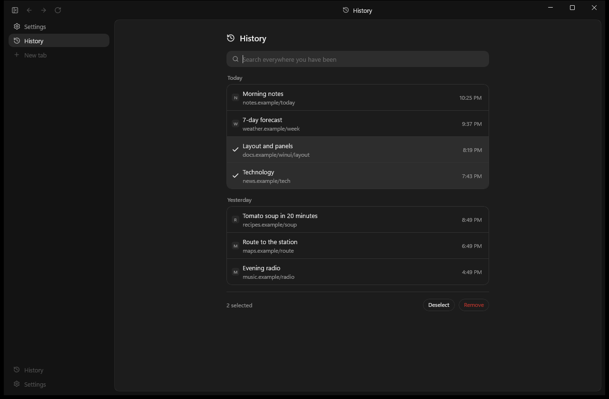

# aerio

A calm, fast browser for Windows: tabs down the left, the page as a card, and nothing else in the way.



Windows 10 (2004) or later · x64 · free

## Where it comes from

aerio is the Windows sibling of [Search](https://github.com/driceroland/Search), a small, quiet browser for the Mac by [Office Commun](https://officecommun.com).

We did not port its code line by line. We took its design, its feel and its style as our inspiration and rebuilt them natively for Windows with C#, WinUI 3 and WebView2. The goal is the same as Search's: fast, light, capable and good-looking.

aerio is not affiliated with or endorsed by Office Commun. The name Search and its icon belong to them and are not used here.

## What carries over

- The vertical tab column. It folds away (Ctrl+S) and slides back in from the left edge.
- The page shown as a card, under a slim top bar with the address field.
- Address field suggestions from your history, with typo tolerance.
- History as its own page, searchable and grouped by day. Select several places with Ctrl or Shift and remove them at once.
- Settings as its own page.
- Light, dark, or following Windows.
- Sessions that come back without waking every tab.
- The same `history.json` and `session.json` formats as the Mac version.

## What is different on Windows

- **Engine.** Chromium, through Microsoft Edge WebView2, instead of WebKit. Chrome extensions work.
- **Ad blocking.** uBlock Origin is built in.
- **Focus mode** (Ctrl+Shift+F). Only the page stays; the tabs and the top bar come out at the edges.
- **Native Windows controls.** System window buttons, Segoe UI Variable and [Lucide](https://lucide.dev) icons. San Francisco and SF Symbols are only licensed for Apple platforms.

## Build

You need the .NET 10 SDK. Visual Studio is not required.

```powershell
dotnet run --project Windows/App
dotnet run --project Windows/Tests
```

`Windows/pack.ps1` builds the installer (`Setup.exe`) and a portable zip with [Velopack](https://velopack.io).

How the app is put together, and how it differs from the Mac version in detail, is in [Windows/README.md](../Windows/README.md) (in Russian).

## Repository layout

| Path | What |
|---|---|
| `Windows/` | aerio: `Core` (logic, no UI), `Tests`, `App` (WinUI 3 window) |
| everything else | Search for macOS, as upstream publishes it, kept as the reference for behaviour and design |

## License

aerio is MIT licensed, like Search: see [LICENSE](../LICENSE), which keeps Office Commun's copyright notice.

It bundles or uses:
- uBlock Origin, GPLv3. Its license ships next to it in `Windows/App/Extensions`.
- Lucide icons, ISC.
- Velopack, MIT.
- Windows App SDK, MIT.
- WebView2 SDK, under Microsoft's license.
