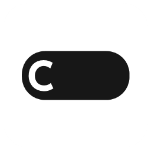
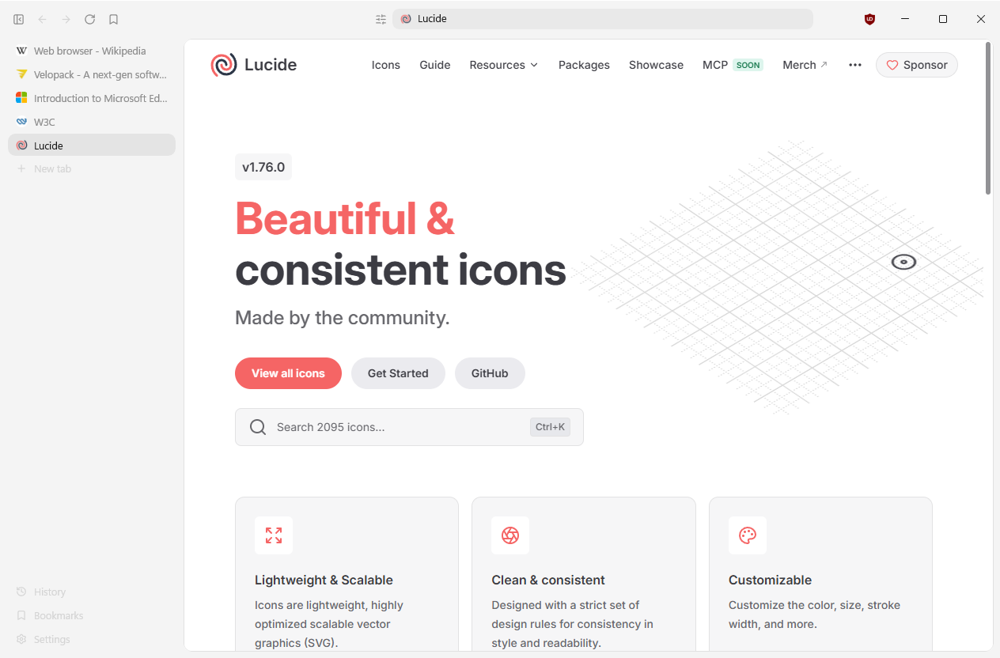

#  Clear

A calm, fast browser for Windows: tabs down the left, the page as a card, and nothing else in the way.



**[Download the beta →](https://github.com/wakeupmetha/Clear/releases)** · Windows 10 (2004) or later · x64 · free

Clear is in beta: it is used every day, but expect rough edges.

## Install

1. Download `clear-browser-win-Setup.exe` from [Releases](https://github.com/wakeupmetha/Clear/releases) and run it.
2. The installer is not code-signed yet, so Windows SmartScreen will warn you. Choose **More info → Run anyway**.

It installs for your user only, with no administrator rights, and adds Clear to the Start menu and the desktop. If Microsoft Edge WebView2 is missing (it can be on Windows 10), the installer adds it.

Prefer not to install? Unzip `clear-browser-win-Portable.zip` and run `Clear.exe`.

Your tabs, history, settings and sign-ins live in `%LOCALAPPDATA%\Clear`. Uninstalling Clear leaves them in place. There are no automatic updates yet: to update, run a newer installer over the old one.

## What it does

- **Tabs down the left.** Pin the ones you keep open, drag to reorder, Ctrl+1–9 to jump. Fold the column away with Ctrl+S.
- **One field.** Type an address or a few words. Suggestions come from your own history and forgive typos.
- **Sessions that come back** without waking every tab; tabs you leave alone go to sleep.
- **History, bookmarks and downloads**, each a page of its own, searchable.
- **Private tabs** (Ctrl+Shift+N) that leave nothing behind.
- **Focus mode** (Ctrl+Shift+F): only the page stays; the tabs and the top bar come out at the edges.
- **Full screen** (F11). A folded tab column slides in from the left edge.
- **Ad blocking** with uBlock Origin, built in. Other Chrome extensions work too.
- **Light, dark,** or following Windows.
- **Your own shortcuts.** Every command can be rebound in Settings.

## Where it comes from

Clear is the Windows sibling of [Search](https://github.com/driceroland/Search), a small, quiet browser for the Mac by [Office Commun](https://officecommun.com).

We did not port its code line by line. We took its design, its feel and its style as our inspiration and rebuilt them natively for Windows with C#, WinUI 3 and WebView2. The goal is the same as Search's: fast, light, capable and good-looking.

Clear is not affiliated with or endorsed by Office Commun. The name Search and its icon belong to them and are not used here.

What is different from the Mac version:

- **Engine.** Chromium, through Microsoft Edge WebView2, instead of WebKit.
- **Native Windows look.** System window buttons, Segoe UI Variable and [Lucide](https://lucide.dev) icons. San Francisco and SF Symbols are licensed for Apple platforms only.
- **Focus mode**, which the Mac version doesn't have.
- The same `history.json` and `session.json` formats as the Mac version.

## Build

You need the .NET 10 SDK.

```powershell
dotnet run --project Windows/App
dotnet run --project Windows/Tests
```

`Windows/pack.ps1` builds the installer and the portable zip with [Velopack](https://velopack.io). The release build is compiled ahead of time (Native AOT), which also needs the MSVC build tools (Visual Studio's "Desktop development with C++" workload).

## Repository layout

| Path | What |
|---|---|
| `Windows/` | Clear: `Core` (logic, no UI), `Tests`, `App` (the WinUI 3 window) |
| everything else | Search for macOS, as upstream publishes it, kept as the reference for behaviour and design |

## License

Clear is MIT licensed, like Search: see [LICENSE](../LICENSE), which keeps Office Commun's copyright notice.

It bundles or uses:

- uBlock Origin, GPLv3. Its license ships next to it in `Windows/App/Extensions`.
- Lucide icons, ISC.
- Velopack, MIT.
- Windows App SDK, MIT.
- WebView2 SDK, under Microsoft's license.
